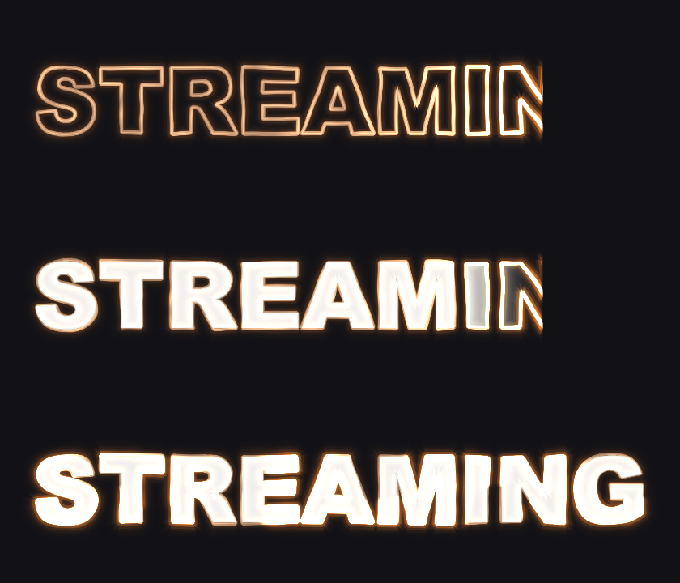
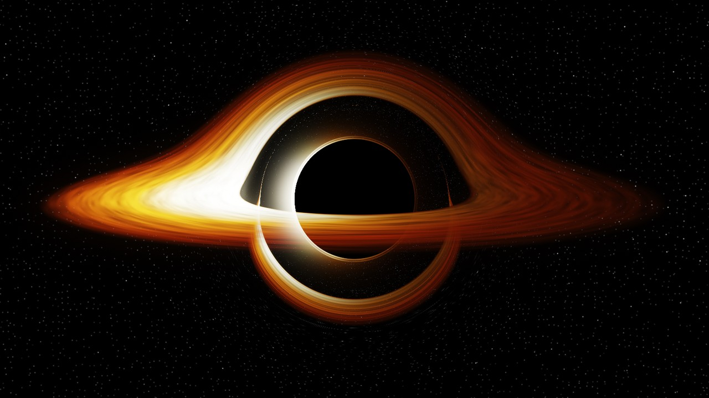

# obs-modern-tv

*Modern TV effects for OBS: digital glitches, a light trace, a black hole, and more to come.*

Shaders para **OBS Studio** con efectos de la televisión y el streaming de hoy: señal digital que se rompe, un trazo de luz para títulos y un agujero negro de película.

Es la colección hermana de [obs-retro-tv](https://github.com/hjmeneses/obs-retro-tv), que va de los efectos de los 60.

*[English below](#english)*

## Requisitos

- OBS Studio
- Plugin [obs-shaderfilter](https://github.com/exeldro/obs-shaderfilter)

## Shaders

| Archivo | Qué hace |
|---|---|
| `glitch.shader` | La escena se rompe sola, como si hackearan el stream: glitches pequeños cada 10–30 s y uno completo cada 30–60 s, en momentos al azar. |
| `trazo-de-luz.shader` | Una línea de luz con núcleo blanco y resplandor recorre el contorno de un texto o logo, al estilo de los plugins de "sable de luz". |
| `gargantua.shader` | Un agujero negro con disco de acreción en tiempo real, inspirado en el de *Interstellar*: el rayo de cada píxel se dobla de verdad alrededor del agujero. |

## Instalación

1. Descarga los archivos `.shader` (o clona el repo).
2. En OBS, clic derecho sobre la escena o fuente → **Filtros** → **+** → **User-defined shader**.
3. Activa **Load shader text from file** y elige el archivo `.shader`.
4. Ajusta los parámetros.

Con [Shader Dock](https://github.com/hjmeneses/shader-dock) (plugin) u [obs-shader-dock](https://github.com/hjmeneses/obs-shader-dock) (de navegador) los controlas desde un dock: encender y apagar el glitch y Gargantúa, o disparar el trazo de luz con ▶.

## Glitch digital (`glitch.shader`)

Simulación aproximada del shader en una escena de ejemplo: un glitch pequeño y luego uno completo. En vivo salen al azar cada 10–30 s y cada 30–60 s. / Approximate simulation: a small glitch, then a full one.

Aplícalo a la **escena** completa (o a una fuente, si solo quieres que falle esa).

| Tipo | Cada cuánto | Qué pasa |
|---|---|---|
| Pequeño | 10–30 s, al azar | Dos o tres tirones: franjas horizontales corridas, separación RGB, algún bloque fuera de lugar |
| Completo | 30–60 s, al azar | Toda la escena se desarma: saltos verticales, pixelado, bloques con colores dañados, líneas de ruido, apagones y destellos. Luego se recupera |

La separación entre dos glitches seguidos siempre queda dentro del rango, aunque lleves horas en vivo. El primero de cada tipo puede llegar antes, porque se cuenta desde que se activa el filtro. Si un pequeño cae durante el completo, manda el completo. Fuera de los glitches la imagen pasa tal cual.

| Parámetro | Efecto |
|---|---|
| Modo | *Normal (al azar)*, o *Probar glitch pequeño / completo* en bucle para ajustarlo sin esperar |
| Glitches pequeños / Glitch completo | Enciende o apaga cada tipo |
| Mínimo / Máximo entre glitches | El rango de segundos entre un glitch y el siguiente |
| Duración / Intensidad | Cuánto dura cada glitch y qué tan fuerte es |
| Separación RGB | Qué tanto se separan los canales de color |
| Tamaño de los bloques | Tamaño de los bloques de compresión dañada |
| Cambios por segundo del glitch | Qué tan "a saltos" se mueve el glitch |
| Semilla | Cambia el patrón de tiempos. Usa una distinta en cada escena para que no fallen todas a la vez |

El conteo empieza cuando se activa el filtro: al recargar el shader o reiniciar OBS empieza de cero.

## Trazo de luz (`trazo-de-luz.shader`)

Capturas del shader en OBS: barrido con la fuente oculta, barrido con la fuente apareciendo detrás de la luz, y modo eléctrico. / Captures from OBS: sweep with the source hidden, sweep revealing the source, electric mode.

Aplícalo a una **fuente de texto, logo o imagen con transparencia**. Como el resplandor sale de la fuente, dale margen con *Expand Left/Right/Top/Bottom* en las opciones del filtro.

Es una secuencia (Progreso de 0 a 100, o en bucle). La luz recorre el contorno durante el 0–70, el contorno queda encendido hasta el 80 y luego se apaga.

| Parámetro | Efecto |
|---|---|
| Modo | *Barrido*: la luz cruza en línea recta. *Giro*: la luz le da la vuelta al título por fuera, como en una pista (por arriba, baja por un extremo, regresa por abajo), con el contorno ya encendido tenue. *Eléctrico*: tramos que se encienden y apagan al azar. *Radar*: una vuelta con velocidad angular constante (en un título ancho se demora en el centro y vuela en los extremos) |
| Dirección | Ángulo del barrido (0 = de izquierda a derecha, 90 = de arriba abajo) o punto de arranque del giro o del radar |
| Fuente | Aparece detrás del trazo, siempre visible u oculta (solo el trazo) |
| Contorno de | Transparencia, o brillo para logos sobre fondo negro |
| Color del núcleo / del resplandor | El centro de la línea y el halo |
| Grosor, alcance e intensidad | Ancho del núcleo, hasta dónde llega el resplandor y qué tan fuerte es |
| Largo de la estela / Brillo que queda | Cuánto dura la cola de luz y cuánto brilla el contorno después |
| Temblor, velocidad de la energía, parpadeo | El temblor del trazo, como de electricidad o fuego |

> Este shader barre la imagen. Si quieres que la luz siga cada contorno en orden, letra por letra y con sus huecos, usa el plugin [Light Trace](https://github.com/hjmeneses/light-trace).

## Gargantúa — agujero negro (`gargantua.shader`)

Captura del shader en OBS a 1080p. / Capture from OBS at 1080p.

Aplícalo a una **fuente de color negro** (o a una escena vacía); no usa la imagen de entrada. Cada píxel lanza un rayo que se dobla alrededor del agujero con la aceleración de un fotón en Schwarzschild, así que el lado lejano del disco aparece arriba y abajo de la sombra. El lado que viene hacia ti brilla más y es más blanco (Doppler), y el anillo de fotones hereda ese mismo color y las vetas del disco. El centro queda negro puro.

| Parámetro | Efecto |
|---|---|
| Radio del agujero | Tamaño de la sombra en pantalla |
| Disco: radio interior / exterior | Dónde empieza y termina el disco, en radios del agujero |
| Disco: grosor | Qué tan opaco es el disco |
| Inclinación de la cámara | Grados sobre el plano del disco: bajo = el arco de arriba casi vertical |
| Velocidad de giro | Qué tan rápido gira el disco |
| Doppler | Diferencia de brillo y color entre el lado que se acerca y el que se aleja |
| Lente gravitacional | 0 = sin curvar la luz, 1 = física completa |
| Brillo del disco / Glow / Exposición | Brillo del disco, resplandor alrededor y exposición final |
| Densidad de estrellas | Estrellas de fondo (0 = sin estrellas) |
| Calidad (pasos del rayo) | 32, 64 o 128 pasos. 64 tarda unos 2.7 ms de GPU a 1080p en una GTX 1650 Ti de laptop |

La spec completa y sus criterios de aceptación están en [`docs/gargantua-spec.md`](docs/gargantua-spec.md); [`tools/gargantua_tests.py`](tools/gargantua_tests.py) los verifica contra OBS por obs-websocket.

---

## English

Shaders for **OBS Studio** with today's TV and streaming effects: a broken digital signal, a light trace for titles and a movie-style black hole. Sister collection of [obs-retro-tv](https://github.com/hjmeneses/obs-retro-tv).

### Requirements

- OBS Studio
- [obs-shaderfilter](https://github.com/exeldro/obs-shaderfilter) plugin

### Shaders

| File | What it does |
|---|---|
| `en/glitch.shader` | Your scene glitches on its own, as if the stream were being hacked: small glitches every 10–30 s and a full-scene glitch every 30–60 s, at random times. |
| `en/light-trace.shader` | A line of light with a white core and a colored glow runs along the outline of a text or logo, in the style of "light saber" plugins. |
| `en/gargantua.shader` | A real-time black hole with an accretion disk, inspired by the one in *Interstellar*: each pixel's ray really bends around the black hole. |

The English versions, with English labels and comments, are in the [`en/`](en) folder; the Spanish originals are in the root.

### Installation

In OBS, right-click the scene or source → **Filters** → **+** → **User-defined shader**, enable **Load shader text from file** and pick the `.shader` file. With [Shader Dock](https://github.com/hjmeneses/shader-dock) (plugin) or [obs-shader-dock](https://github.com/hjmeneses/obs-shader-dock) (browser) you control them from a dock: switch the glitch and Gargantua on and off, or fire the light trace with ▶.

**Glitch**: apply it to the whole scene (or to one source). Set *Mode* to one of the *Test* options to loop a glitch while you tune it. The gap between two glitches always stays within the configured range, however long you are live. Use a different *Seed* on each scene so they don't all glitch together.

**Light trace**: apply it to a text, logo or image with transparency, and give the glow room with the filter's *Expand* options. It is a sequence (Progress 0–100, or loop): the light runs along the outline over 0–70, the outline stays lit until 80, then fades. Modes: *Sweep* (straight line), *Spin* (the light runs around the outside of the title like on a track, over a dimly lit outline), *Electric* (random flickering stretches) and *Radar* (once around at a constant angular speed). The source can appear behind the light, stay visible, or be hidden. This shader sweeps the image; for a light that follows each outline in order, letter by letter including the holes, use the [Light Trace](https://github.com/hjmeneses/light-trace) plugin.

**Gargantua**: apply it to a black color source (or an empty scene); it ignores the input image. Each pixel traces a ray that bends around the black hole like a photon in Schwarzschild spacetime, so the far side of the disk shows above and below the shadow. The side moving towards you is brighter and whiter (Doppler), and the photon ring takes the same color and the disk's streaks. The center stays pure black. Parameters: black hole radius, disk inner/outer radius and thickness, camera inclination, rotation speed, Doppler, gravitational lensing (0 = straight light, 1 = full physics), disk brightness, glow, star density, exposure, and quality (32/64/128 ray steps; 64 takes about 2.7 ms of GPU at 1080p on a laptop GTX 1650 Ti). The full spec and its acceptance criteria are in [`docs/gargantua-spec.md`](docs/gargantua-spec.md), and [`tools/gargantua_tests.py`](tools/gargantua_tests.py) checks them against OBS over obs-websocket.

## License

MIT
